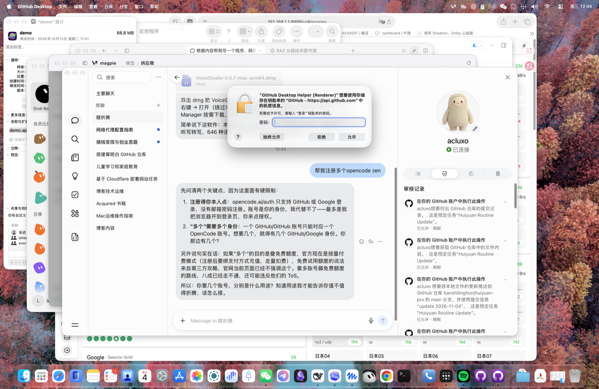

# GitHub Desktop 中文汉化补丁（macOS 版）

[](#) [](#) [](LICENSE.md) [](README.zh-CN.md)

非官方的 **GitHub Desktop 3.6.10 (macOS)** 简体中文汉化补丁。

同一套词库与翻译引擎，针对 macOS 版原生构建重新生成——Windows 版补丁包无法直接用于 macOS（载荷哈希不同、安装器是 PowerShell、菜单源串带 `&` 助记符、英文文案大小写也不同）。本项目解决了这些差异，让 macOS 用户也能一键汉化。

| 文件 | 替换处数 | 说明 |
|---|---|---|
| `main.js` | 121 | 主进程菜单、原生对话框（另修正 3 处 Electron role 英文标签：窗口 / 帮助 / 最小化 / 缩放 / 关闭） |
| `renderer.js` | 2225 | 主窗口 UI：欢迎页、设置、差异、提交、分支、仓库列表…… |
| `crash.js` | 6 | 崩溃页 |
| **合计** | **2352 处 / 1857 条不同文案** | Windows 版包自报 2422 处，差额为 Windows 专属代码 |



## 快速开始

```bash
git clone https://github.com/banshilinghun/github-desktop-zh-mac.git
cd github-desktop-zh-mac

# 先完全退出 GitHub Desktop（⌘Q），然后：
./install.sh                                    # 安装（默认 /Applications/GitHub Desktop.app）
./install.sh --verify                           # 只校验兼容性，不改任何文件
./install.sh --restore                          # 还原英文原版
./install.sh --app "$HOME/Applications/GitHub Desktop 中文.app"   # 指定应用
```

在 GitHub Desktop 完全退出的状态下运行；安装器会先校验再备份，再逐文件原子替换，失败自动回滚。

## 工作原理

1. **词库替换引擎**：基于 [Johnserf-Seed/GitHub-Desktop-Chinese-Language-Pack](https://github.com/Johnserf-Seed/GitHub-Desktop-Chinese-Language-Pack) 的 MIT 引擎（含内嵌 acorn 解析器），对每个字符串字面量解析其源映射（source map）归属，只替换白名单源文件里的界面文案；替换后做 AST 结构等价比对，保证除字符串字面量外程序结构不变。
2. **macOS 菜单补充词库**（`zh/dictionary-mac-supplement.json`，76 条）：macOS 构建的菜单源串不带 Windows 的 `&` 助记符（`File` vs `&File`），按 mac 实际源串重写译文，来源限定菜单模块，不误伤 `File/View/Copy` 这类通用词。
3. **大小写别名**（189 条生效）：两个构建的英文存在大小写差异（`…on your local drive…` vs `…on your Local Drive…`），自动对齐译文，并沿用引擎「像界面文案」的判定，跳过 octicon 名、CSS 类名、状态键、dispatcher/stores 等非展示字符串。
4. **Electron role 标签**：`{role:"window"}`、`{role:"help"}` 等由 Electron 生成英文默认标签，源码中没有可替换字符串；构建器做定点插入（`label:"窗口"` 等），每条必须恰好命中一次并重新解析验证。
5. **哈希锁定可复现构建**：`payload/manifest.json` 锁定每个文件的原始/补丁 SHA-256；`scripts/build.cjs` 重新生成时逐字节比对，不一致直接报错，不产出半成品。

## 目录结构

```
install.sh / restore.sh          macOS 安装 / 还原（校验、备份、原子替换、回滚、本地重签）
payload/                         补丁产物（main.js / renderer.js / crash.js + manifest）
zh/                              词库：dictionary.json（基础）、dictionary-mac-supplement.json（mac 补充）、
                                 dictionary-mac-merged.json（构建时合并结果）、
payload/translation-report.json 每处替换的来源与 143 条待审候选
scripts/build.cjs                生成器：从原始应用重新构建补丁（Node 22+）
engine/                          翻译引擎（MIT，源自 Johnserf-Seed 项目）+ 内嵌 acorn
docs/使用说明.txt                 详细中文说明（坑、排错、App 管理权限、钥匙串弹窗）
license/                         第三方许可
```

## 重新生成

```bash
node scripts/build.cjs "/Applications/GitHub Desktop.app" ./payload
```

要求 Node.js 22+，目标必须是官方原始的 GitHub Desktop 3.6.10（原文哈希不符会拒绝）。

## 三个必须知道的点

1. **首次启动会弹钥匙串**：本地重签名后系统认为「不是同一个 App」，会弹 `GitHub Desktop Helper 想要访问你的钥匙串`，点一次**始终允许**即可，之后不再弹。这是重签名的必然结果，不是补丁在偷密码。
2. **macOS「App 管理」权限**：它保护其他开发者签名的应用包。直接对 `/Applications` 里的官方版执行可能得到 `Operation not permitted`。两条路：系统设置 → 隐私与安全性 → App 管理，放行你的终端；或者新建一个未签名副本（rsync 排除 `_CodeSignature`）→ 打补丁 → `codesign --force --deep --sign -` 本地重签（本机即采用此法，官方原版保持不动）。
3. **官方自动更新会盖掉补丁**：更新后需重跑 `scripts/build.cjs` 生成新版补丁，词库与哈希校验对不上时会明确报错而不是产出半成品。

## 仍为英文的部分

- Git、GitHub 服务器、Copilot 实时返回的文本；外部网页；诊断日志
- 产品名 / 模型名 / 快捷键 / 文件名 / 示例地址 / 用户内容（按原样保留）
- `translation-report.json` 里 143 条引擎判定「像 UI」但词库未收录的 pending 候选，未擅自翻译

## 许可

MIT（见 [LICENSE.md](LICENSE.md)）。翻译引擎与基础词库改编自 Johnserf-Seed 的 MIT 项目，acorn 许可见 [license/](license/)。
本项目为非官方汉化，与 GitHub 无隶属关系；GitHub、GitHub Desktop 及其徽标为 GitHub, Inc. 的商标。
